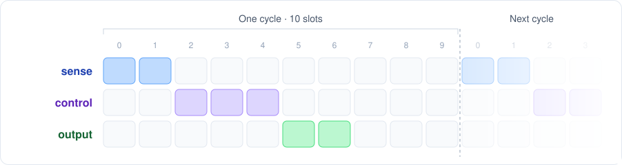

# Zule

Zule is a lightweight, static task scheduler for C applications where
predictable timing is critical. Every task runs in a fixed
window of a repeating cycle. The schedule is defined ahead of time and checked
before the application is built, so its timing can be reviewed and reasoned about.



- **Fixed, offline-checked timing.** The schedule is a JSON file, validated and
  turned into C at build time.
- **A schedule for each mode.** Define several schedules, such as start-up and
  operation, and switch between them at a cycle boundary while running.
- **Overruns are caught.** A task that misses its window, or is still running
  at the end of it, raises a fault immediately.
- **No preemption between tasks.** Tasks run one after another, so data shared
  between tasks needs no locking.
- **Small and portable.** A C99 core with no dynamic allocation or I/O, and a
  small port API for each target.

Zule is pre-release, and its interfaces may still change. A POSIX port supports
development on Linux; embedded ports are planned.

## Getting started

### Set up the environment

Clone the repository:

```sh
git clone https://github.com/SleepyJack/zule.git
cd zule
```

Then set up its tools in one of two ways:

- **Native, on Linux.** You need a C compiler and Python 3.10 or later; a
  Python environment provides CMake and the other tools:

  ```sh
  python3 -m venv .venv
  . .venv/bin/activate
  python -m pip install -r requirements-dev.txt
  ```

- **In a container.** With Docker or Podman, the
  [development image](.devcontainer/README.md) has every tool installed. Build
  it and start a shell in it:

  ```sh
  docker build -f .devcontainer/Dockerfile -t zule-dev .
  docker run --rm -it --user "$(id -u):$(id -g)" --env HOME=/tmp \
      --volume "$PWD:/work" --workdir /work zule-dev
  ```

### Build the showcase

The [showcase example](examples/showcase/README.md) tours Zule's features. Build
it for the host, the `posix` target:

```sh
cd examples/showcase
cmake --preset posix
cmake --build --preset posix
```

### Run the showcase

```sh
../../build/examples/showcase/posix/zule_showcase
```

Each task prints its name when it runs, and the cycle repeats every 500 ms.
Every 5 seconds, the showcase also reports measured task and tick timing:

```text
Zule showcase: running until a fault
sense
control
output
sense
...
```

Press Ctrl-C to stop. The [examples](examples/README.md) include others, such as
the smallest complete application.

## Writing an application

1. **Define the schedule** in JSON. Each task gets a budget in slots, and each
   window places a task at a start slot ([configuration](doc/configuration.md#schedule)):

   ```json
   {
     "slot_us": 10000,
     "tasks": {
       "read_sensors": { "budget_slots": 2 },
       "update_control": { "budget_slots": 3 }
     },
     "cycle": {
       "slots": 10,
       "windows": [
         { "task": "read_sensors", "start_slot": 0 },
         { "task": "update_control", "start_slot": 2 }
       ]
     }
   }
   ```

2. **Implement each task** as `zule_task_<name>()`, and **start the scheduler**
   with `zule_run()` ([application](doc/application.md)):

   ```c
   #include "zule.h"

   void zule_task_read_sensors(void) {
       /* Sample inputs. */
   }

   void zule_task_update_control(void) {
       /* Compute and apply outputs. */
   }

   int main(void) {
       const zule_result_t result = zule_run(); /* Returns only on a fault or port error. */
       return result == ZULE_RESULT_OK ? 0 : 1;
   }
   ```

3. **Build with CMake.** Add Zule, select a port, and generate the schedule
   ([CMake integration](doc/application.md#cmake-integration)):

   ```cmake
   set(ZULE_PORT posix CACHE STRING "Zule port")
   add_subdirectory(path/to/zule zule)

   add_executable(app main.c)
   target_link_libraries(app PRIVATE zule::zule)
   zule_add_schedule(app SCHEDULE config/schedule.json)
   ```

Next, add a [fault handler](doc/application.md#fault-handler) and, optionally,
[task names](doc/configuration.md#task-names-and-ids) for diagnostics, or
[hooks](doc/application.md#hooks) to measure task timing. The
[minimal example](examples/minimal/) is exactly this application, and the
[showcase example](examples/showcase/) adds those features.

## Design documentation

The documentation follows the components of the [architecture](doc/architecture.md):

| Document | Covers |
| --- | --- |
| [Architecture](doc/architecture.md) | Components, ownership, and execution contexts. |
| [Configuration](doc/configuration.md) | Schedule format, task names and IDs, and build settings. |
| [Application](doc/application.md) | Tasks, the public API, fault handling, and integrating Zule into a build. |
| [Core](doc/core.md) | Scheduler behaviour, timing, and faults. |
| [Modules](doc/modules.md) | Optional on-target consumers of scheduler events. |
| [Port](doc/port.md) | The port contract, and creating and linking a custom port. |

To work on Zule itself, see [CONTRIBUTING.md](CONTRIBUTING.md) and
[TESTING.md](TESTING.md).

## Licence

Zule is available under the [MIT License](LICENSE).
