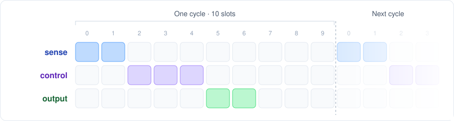

# Zule

Zule is a lightweight, static task scheduler for C applications where
predictable timing is critical. Every task runs in a fixed
window of a repeating cycle. The schedule is defined ahead of time and checked
before the application is built, so its timing can be reviewed and reasoned about.



- **Fixed, offline-checked timing.** The schedule is a JSON file, validated and
  turned into C at build time.
- **Overruns are caught.** A task that misses its window, or is still running
  at the end of it, raises a fault immediately.
- **No preemption between tasks.** Tasks run one after another, so data shared
  between tasks needs no locking.
- **Small and portable.** A C99 core with no dynamic allocation or I/O, and a
  small port API for each target.

Zule is pre-release, and its interfaces may still change. A POSIX port supports
development on Linux; embedded ports are planned.

## Getting started

Run the demo on Linux. You need Git, a C compiler, and Python 3.10 or later;
the Python environment provides CMake and the other tools.

```sh
git clone https://github.com/SleepyJack/zule.git
cd zule
python3 -m venv .venv
. .venv/bin/activate
python -m pip install -r requirements-dev.txt

cmake -S demo -B build/demo -G Ninja
cmake --build build/demo
./build/demo/zule_demo
```

Each task prints its name when it runs, and the cycle repeats every 500 ms:

```text
Zule demo: running until a fault; press Ctrl-C to exit
sense
control
output
sense
...
```

Press Ctrl-C to stop. See the [demo README](demo/README.md) for what it shows.

## Writing an application

1. **Define the schedule** in JSON. Each task gets a budget in slots, and each
   window places a task at a start slot ([configuration](doc/configuration.md#schedule)):

   ```json
   {
     "slot_us": 10000,
     "tasks": {
       "read_sensors": { "budget_slots": 2 },
       "update_control": { "budget_slots": 3 }
     },
     "cycle": {
       "slots": 10,
       "windows": [
         { "task": "read_sensors", "start_slot": 0 },
         { "task": "update_control", "start_slot": 2 }
       ]
     }
   }
   ```

2. **Implement each task** as `zule_task_<name>()`, and **start the scheduler**
   with `zule_run()` ([application](doc/application.md)):

   ```c
   #include "zule.h"

   void zule_task_read_sensors(void) {
       /* Sample inputs. */
   }

   void zule_task_update_control(void) {
       /* Compute and apply outputs. */
   }

   int main(void) {
       const zule_result_t result = zule_run(); /* Returns only on a fault or port error. */
       return result == ZULE_RESULT_OK ? 0 : 1;
   }
   ```

3. **Build with CMake.** Add Zule, select a port, and generate the schedule
   ([CMake integration](doc/application.md#cmake-integration)):

   ```cmake
   set(ZULE_PORT posix CACHE STRING "Zule port")
   add_subdirectory(path/to/zule zule)

   add_executable(app main.c)
   target_link_libraries(app PRIVATE zule::core)
   zule_add_schedule(app SCHEDULE config/schedule.json)
   ```

Next, add a [fault handler](doc/application.md#fault-handler) and, optionally,
[task names](doc/configuration.md#task-names) for diagnostics. The
[demo](demo/) puts all of this together.

## Design documentation

The documentation follows the components of the [architecture](doc/architecture.md):

| Document | Covers |
| --- | --- |
| [Architecture](doc/architecture.md) | Components, ownership, and execution contexts. |
| [Configuration](doc/configuration.md) | Schedule format, task names and IDs, and build settings. |
| [Application](doc/application.md) | Tasks, the public API, fault handling, and integrating Zule into a build. |
| [Core](doc/core.md) | Scheduler behaviour, timing, faults, and implementation notes. |
| [Port](doc/port.md) | The port contract, and creating and linking a custom port. |

To work on Zule itself, see [CONTRIBUTING.md](CONTRIBUTING.md).
