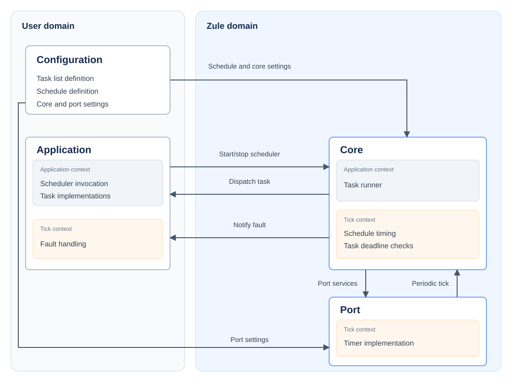

# Zule architecture

Zule is a static, time-triggered scheduler. Tasks execute within predefined bounded time windows in a repeating schedule cycle.

An application supplies a schedule and task implementations. The core manages the scheduling of tasks. A port supplies target-specific implementations for core functions (e.g. timing).

## System overview

## Ownership

There are two ownership domains: the user domain and the Zule domain. The **application** and application-specific **configuration** are owned by the user. The Zule **core** and **port** reside in the Zule ownership domain.

## Components

### Configuration

The configuration defines the set of tasks and the schedule as well as high-level configuration settings for the application.

### Application

The application defines the implementation of the tasks and the high-level interactions with the scheduler (starting, stopping, fault handling).

### Core

The scheduler core dispatches tasks to be run according to the schedule and enforces schedule-defined timing constraints on task execution.

### Port

Target-specific implementations of services to support the scheduler: timing and data synchronisation.

## Execution Contexts

There are two execution contexts that span the various components: **application context** and **tick context**.

### Application Context

All application tasks run in the application context. Application tasks run sequentially according to the defined schedule. There is no concurrency, preemption, or context switching between Zule tasks, so shared inter-task data requires no synchronisation. (The mechanisms used for inter-task communication are outside the scope of the Zule project, but can be public function calls or shared data with no need for concurrency considerations.) The invocation of the Zule scheduler entry point is from the application context: all tasks will run from this same context.

### Tick Context

The periodic timing tick used for task scheduling executes from the tick context. The implementation of the periodic tick is port-defined. For most targets the expectation is that the tick will execute from a timer-driven ISR (although this is not necessarily the case; for example, the POSIX port uses a thread for the tick timer). Synchronisation is required for data shared between tick and application contexts (synchronisation implementation is provided by the port).
