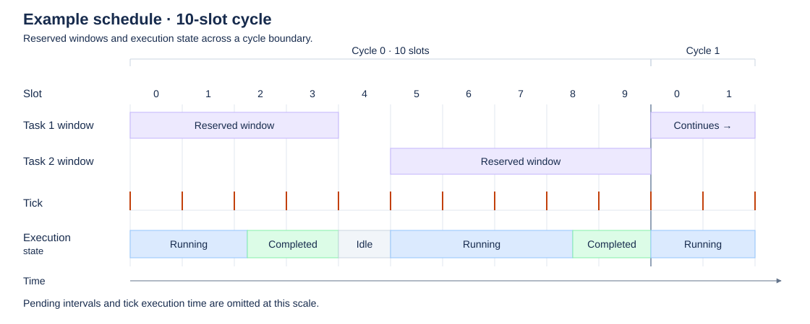
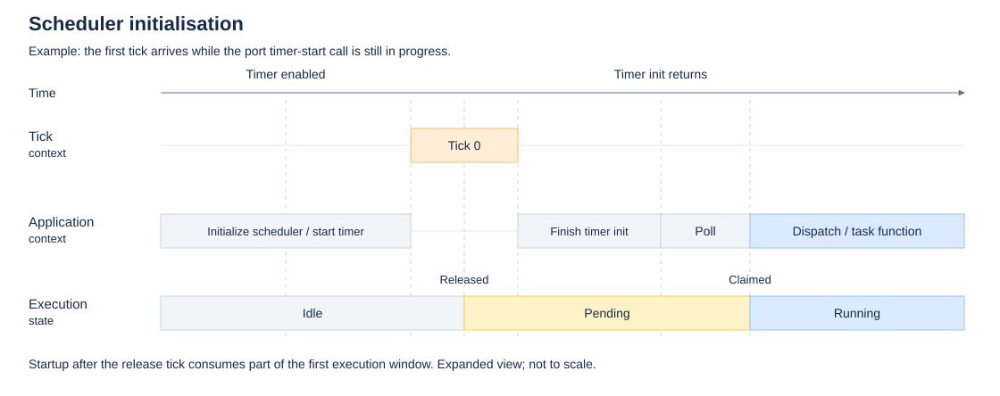
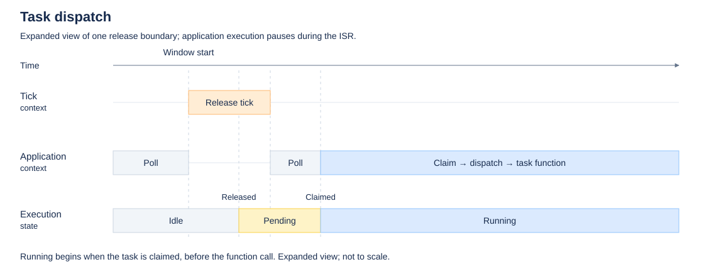
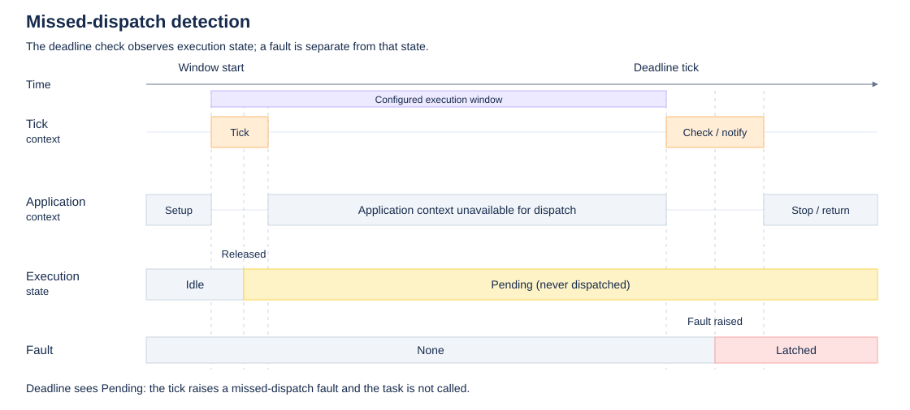
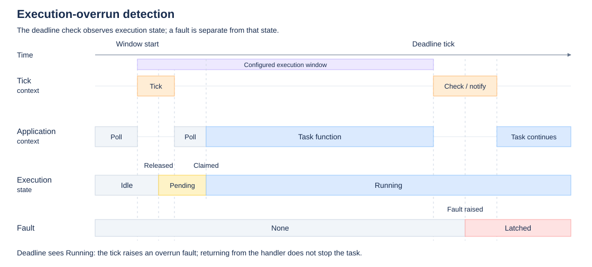

# Core

The core is the scheduler: it dispatches tasks according to the schedule and
enforces the schedule's timing. This document describes its behaviour and
timing model. See the [architecture overview](architecture.md) for components
and execution contexts.

## Scheduling overview

Tasks are allocated fixed execution windows within a repeating cycle of slots.
The [port](port.md) delivers a tick at the start of each slot.

The tick handles window boundaries in [tick context](architecture.md#tick-context).
At a window's start, it marks the task as pending, and
[application context](architecture.md#application-context) then dispatches and
runs it. Early completion does not advance the schedule, and unallocated slots
are idle.

### Task execution states

| State | Description |
|-------|-------------|
| Idle | No active task execution. |
| Pending | Task is awaiting dispatch. |
| Running | Task has been dispatched; completion is not yet recorded. |
| Completed | Task function has returned and completion is recorded. |

| Transition | Context | Condition |
| --- | --- | --- |
| Idle → Pending | Tick | The task's window begins. |
| Pending → Running | Application | The application loop dispatches the pending task. |
| Running → Completed | Application | The task returns and the scheduler records completion. |
| Completed → Idle | Tick | The task's window ends. |

The example below shows two tasks in a ten-slot cycle. Each remains completed
until its window ends. Pending intervals are omitted at this resolution; see
[task dispatch](#task-dispatch).

## Timing

### Startup

The first tick processes slot zero, and can arrive before the port's timer
initialization returns. The first task can then become pending before the
application loop is ready to dispatch it, and startup overhead consumes part of
its window. With [multiple schedules](configuration.md#multiple-schedules), a
startup schedule of idle slots, followed by a task that
[switches](#schedule-switching) to the operational schedule, absorbs this
latency without costing slots in every cycle.

### Task dispatch

State transitions are protected by critical sections, but task functions run
outside them, so ticks continue during task execution. When no task is pending,
the dispatch loop waits for the next tick through the port's [idle](port.md#idle).

The detailed diagrams show an ISR interrupting application execution and are
not to scale.

### Schedule switching

A task can [request another schedule](application.md#switching-schedules). The
switch takes effect at the start of the next cycle, after the current schedule's
final window, so a cycle always runs to completion in one schedule. All
schedules share the slot length, so ticks continue at the same rate.

### Deadline monitoring

At a window's end, tick context checks the task's state. A task still pending
raises a **missed-dispatch** fault: it was not dispatched within its window.

A task still running raises an **execution-overrun** fault. Completion must be
recorded before the deadline, so the budget must include returning from the
task. Detecting the fault does not terminate the task function.

### Tick timing check

The optional tick timing check compares each tick's time with when it should
have arrived, using the port's [timebase](port.md#timebase). The first tick of a
run is the reference, and each later tick is expected exactly one slot after the
previous expected time. Because the expectation is absolute, the check catches
slow drift as well as single late ticks, and a lost tick shows as a deviation of
a whole slot. A tick that deviates by more than the
[tolerance](configuration.md#tick-timing-tolerance), early or late, raises a
**tick timing** fault.

The check has limits. A late first tick shifts the reference unnoticed. With no
ticks at all, nothing is checked; that needs independent monitoring, such as a
watchdog. If the port derives the timebase from its tick timer, a lost tick is
invisible to both.

## Fault handling

A fault halts the schedule and prevents further dispatch. The first fault stays
latched until the next run; later faults do not replace it. The application's
[fault handler](application.md#fault-handler) is called once, immediately, in
tick context, so the application can respond while a task is still running.

The scheduler then waits for any running task to return, stops tick delivery,
and returns the fault from `zule_run()`. A task that never returns prevents
this.

## Hooks

The core reports scheduler events to enabled [modules](modules.md) and the
application's [hooks](application.md#hooks), with a timebase timestamp for each:

| Event | Context |
| --- | --- |
| Tick start and end | Tick |
| Task release, when a window starts | Tick |
| Schedule switch | Tick |
| Task start and end, around each task call | Application |

Hooks observe; they cannot change scheduling. Unused hooks compile to nothing.

## Timing assumptions

The port is responsible for timer accuracy, reliable tick delivery, and
exclusion between tick and application contexts. Task budgets must cover
scheduler overhead and interrupt interference as well as task execution time.
