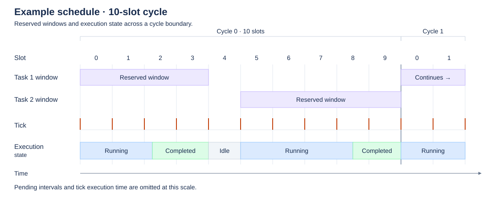
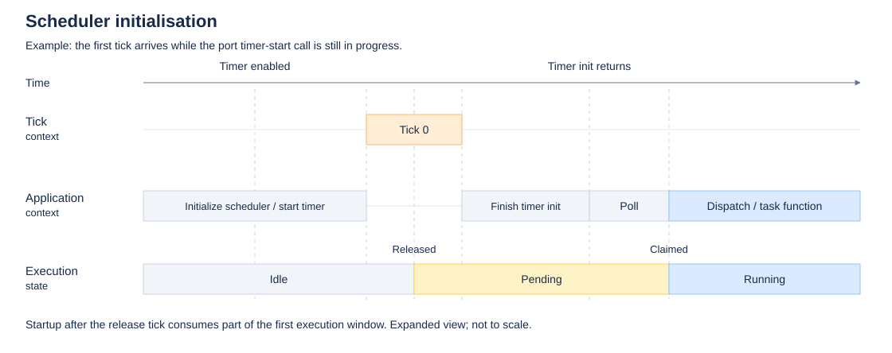
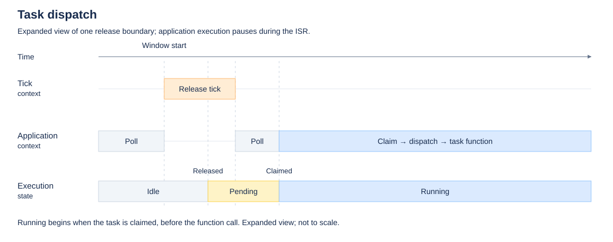
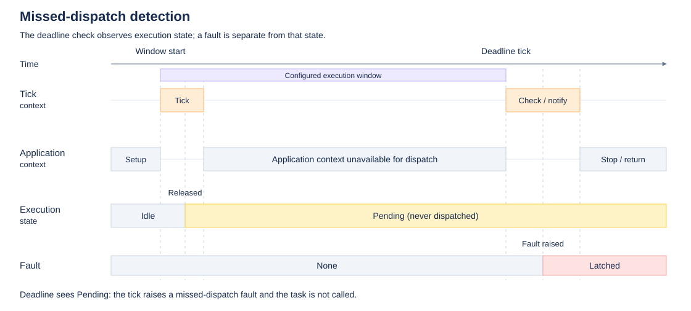
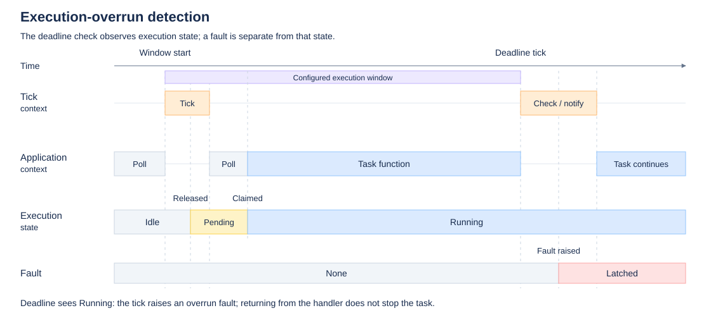

# Core

The core is the scheduler: it dispatches tasks according to the schedule and
enforces the schedule's timing. This document describes its intended behaviour
and timing model, followed by [implementation notes](#implementation). See the
[architecture overview](architecture.md) for components and execution contexts.

## Scheduling overview

Tasks are allocated fixed execution windows within a predefined cyclic
schedule. The cycle is divided into slots, with slot timing defined by a
periodic timer implemented by the [port](architecture.md#port).

The tick handles window boundaries in [tick context](architecture.md#tick-context),
normally a timer ISR. At a window's start, it marks the task as pending;
[application context](architecture.md#application-context) then
dispatches and executes the task. Early completion does not advance the
schedule. Unallocated slots are idle.

### Task execution states

The scheduler tracks task execution using the following states.

| State | Description |
|-------|-------------|
| Idle | No active task execution. |
| Pending | Task is awaiting dispatch. |
| Running | Task has been dispatched; completion is not yet recorded. |
| Completed | Task function has returned and completion is recorded. |

The normal state transitions are below.

| Transition | Context | Condition |
| --- | --- | --- |
| Idle → Pending | Tick | The task's window begins. |
| Pending → Running | Application | The application loop dispatches the pending task. |
| Running → Completed | Application | The task returns and the scheduler records completion. |
| Completed → Idle | Tick | The task's window ends. |

The example below shows two tasks in a ten-slot cycle. Each remains in the
completed state until its window ends. Pending intervals are omitted at this
resolution; see [task dispatch](#task-dispatch) for the detailed timing.

## Scheduler timing details

### Scheduler initialisation

The scheduler entry point validates the schedule, starts the port timer, and
enters the application dispatch loop. The first tick processes slot zero.

If the first tick occurs before timer initialization returns, the first task
can become pending before the application loop is ready to dispatch it.
Startup overhead then consumes part of the first window's budget. Leaving
initial slots idle allows time for initialization.

### Task dispatch

At a window's start, tick context marks the task as pending. The application
dispatch loop sets the state to running before calling the task function.
Critical sections protect these [state transitions](#task-execution-states).
Task functions execute
outside the critical sections, allowing ticks to run during task execution.

The scheduler records completion after the task function returns. At the
window's end, tick context returns the execution state to idle before processing
the next window.

The detailed diagrams illustrate an ISR interrupting application execution and
are not to scale. The POSIX port instead uses a timer thread.

### Task deadline monitoring

At a window's end, tick context checks the task's execution state. A task still
pending raises a **missed-dispatch** fault: it was not dispatched within its
window and will not be dispatched after the fault.

A task still running raises an **execution-overrun** fault. Completion must be
recorded before the deadline check, so the window must include the overhead of
returning from the task and updating its state. [Fault detection](#fault-handling) does not
terminate the task function.

## Fault handling

A fault halts schedule progression and prevents further task dispatch. The
first fault remains latched until [reinitialization](#scheduler-initialisation);
subsequent checks do not replace it or repeat notification.

The application can supply a [fault handler](application.md#fault-handler),
invoked immediately in tick context. This allows the application to respond
independently of a running task. The handler must be bounded and nonblocking,
and must not call Zule APIs.

Tick processing continues while a running task completes. Once application
context observes the fault, the scheduler stops tick delivery and waits for any
active tick handler before returning. An executing task must return before the
scheduler entry point can return.

## Timing assumptions

The port is responsible for timer accuracy, reliable tick delivery, and
synchronization between tick and application contexts. Scheduler timing depends
on delivered ticks, so detecting timer failure may require independent
monitoring, such as a watchdog.

Task budgets must account for scheduler overhead and interrupt interference as
well as task execution time.

## Implementation

The core lives in `zule/core/`:

| Path | Contents |
| --- | --- |
| `api/` | Public headers: `zule.h` and the settings header `zule_config.h`. |
| `inc/` | Internal headers, visible only to the core, its tests, and generated schedules. |
| `src/zule.c` | Public API: configuration, task-name lookup, and the `zule_run()` loop. |
| `src/zule_scheduler.c` | Tick processing, dispatch, execution state, and fault latching. |
| `src/zule_schedule.c` | Schedule validation. |
| `tests/` | Unit tests, built against a deterministic, single-threaded test port. |

### Schedule data

`inc/zule_schedule.h` defines the schedule types, and
`inc/zule_schedule_definition.h` declares the getter `zule_schedule_get()`, which
the generated schedule implements. A schedule holds `slot_us`, the cycle length,
an immutable task array, and a window array. Each task entry holds its ID and
function pointer, plus a name when [task names](configuration.md#task-names) are
enabled. Windows point into the task array, so repeated windows share one entry.
Mutable execution state is private to `src/zule_scheduler.c`.

Handwritten schedules are possible; they supply their own unique task IDs.

### Validation

Initialization validates the schedule before ticks start, whether it was
generated or handwritten. `zule_schedule_validate()` checks:

- pointers, a nonzero slot period, counts, and budgets;
- task functions and unique task IDs;
- window task references, bounds, ordering, and overlap.

End-bound checks avoid unsigned overflow. On failure, initialization returns
`ZULE_RESULT_INVALID_SCHEDULE` and leaves tick and dispatch disabled. Validation
checks structural timing consistency only: whether tasks finish within their
budgets, and whether schedule storage remains valid, need evidence from outside
the core.

### Runner

`zule_run()` initializes the scheduler, passes `zule_scheduler_tick()` to
`zule_port_tick_init()` as the tick callback, then alternates
`zule_scheduler_run()` with `zule_port_idle()`. Each scheduler run attempts one
dispatch, protecting the task handoff and completion with port critical
sections. A scheduler fault or port error ends the loop, after which the runner
stops the tick. The core has no clock source of its own and does not depend on
how the port delivers ticks.
